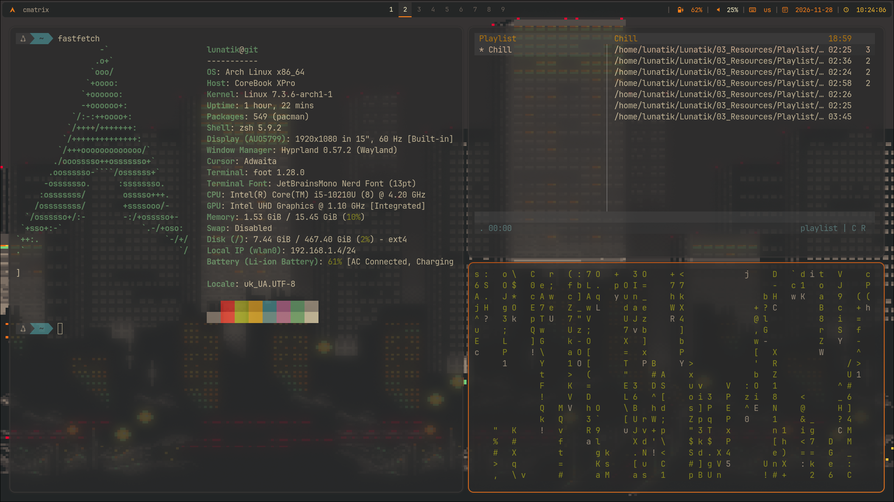
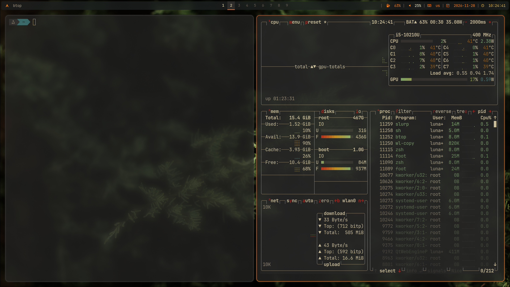
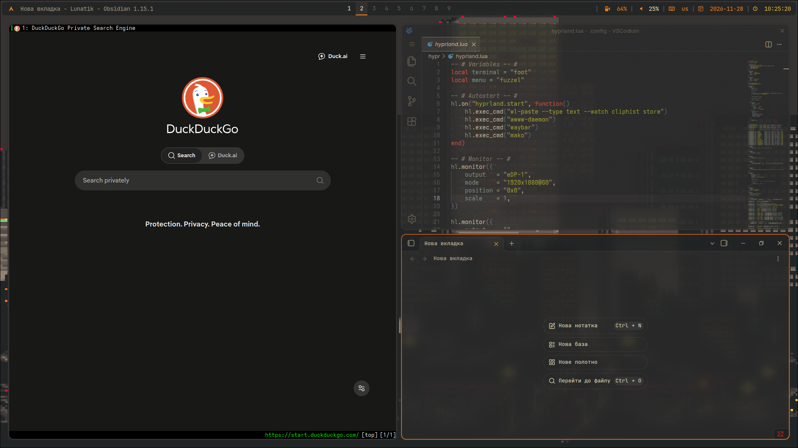
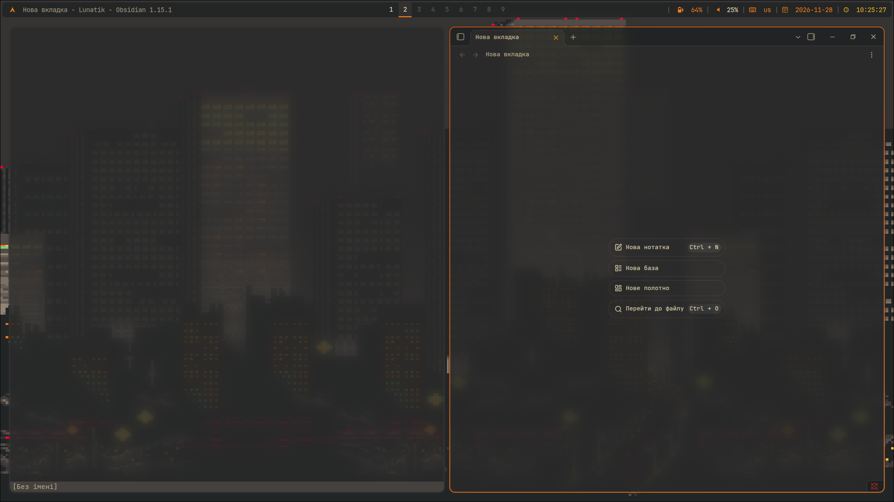

# Hyprland-Gruvbox
Just my hyprland rice

Keybinds:
## ALT - mod key

## Workspaces:
### mod + 1 - 9 change workspace
### mod + Shift + 1 - move window to workspace

## Windows:
### Keys:
### mod + Shft + Q - close focus window
### mod + Arrows - change window focus
### mod + Ctrl + Arrows - resize window focus
### mod + Shift + Arrows - resize window focus

### Mouse:
### mod + LMB - move window
### mod + RMB - resize window

## Programs:
### mod + D - run fuzzel (app launcher)
### mod + Enter - open terminal

## Utils:
### mod + W - change wallpapers
### mod + Shift - screenshot (save to /home/user)
### mod + Shift + S - screenshot (save to clipboard)
